<p align="center">
  
</p>

# 📑 Awesome Sales Proposal & Document Automation 🚀

<a href="https://github.com/ishandutta2007/Awesome-Awesome-Awesome"></a><a href="https://discord.gg/jc4xtF58Ve"></a>
[](https://awesome.re)
[](https://github.com/ishandutta2007/Awesome-Sales-Proposal-Document-Automation)
[](LICENSE)
[](http://makeapullrequest.com)
<a href="https://github.com/ishandutta2007"></a>

> 💼 A curated directory of software-as-a-service (SaaS) platforms and open-source projects for **Sales Proposal Automation**, **Configure-Price-Quote (CPQ)** workflows, **RFP (Request for Proposal) Response Automation**, and **Self-Hosted Document Generation Engines**. ⚡

---

## 🌐 Sector Overview & Market Dynamics

The global **Proposal Management & Document Automation Software** market is valued at approximately **$3.66 Billion in 2026** (with the broader document automation and generation market reaching ~$6.20 Billion), expanding at a compound annual growth rate (**CAGR**) between **11.2% and 13.6%** through the 2030s. The sector is **moderately fragmented**—broad ecosystem giants (HubSpot, Salesforce CPQ) and document unicorns (PandaDoc) dominate multi-tenant contract signing and standard quote-to-close workflows, while specialized, high-ACV enterprise response management vendors (Responsive/RFPIO, Loopio) maintain strong defensibility in technical RFP and security questionnaire workflows. Concurrently, an emerging wave of agile, AI-native startups and open-source agentic pipelines is unbundling static PDF proposal generation.

---

## 📑 Table of Contents

- [🌐 Sector Overview & Market Dynamics](#-sector-overview--market-dynamics)
- [☁️ SaaS / Commercial Platforms](#️-saas--commercial-platforms)
- [🔓 Open-Source GitHub Projects](#-open-source-github-projects)
  - [⭐ Open-Source Projects Table](#-open-source-projects-ranked-by-stars)
  - [🔍 Detailed Project Descriptions](#-detailed-project-descriptions)
- [⚖️ Comparison: SaaS vs. Open-Source](#️-comparison-saas-vs-open-source)
- [🤝 How to Contribute](#-how-to-contribute)
- [💖 Support & Sponsorship](#-support--sponsorship)
- [📜 Disclaimer](#-disclaimer)
- [📈 Star History](#-star-history)

---

## ☁️ SaaS / Commercial Platforms

The following table benchmarks top commercial sales proposal and document automation platforms, ordered descending by organizational scale (market capitalization or valuation/ARR).

| Product | Pricing (Starting Tier) | Free Tier Limits / Free Trial | Company Scale (Valuation / Revenue) | Core Strengths |
| :--- | :--- | :--- | :--- | :--- |
| **[HubSpot Sales Hub](https://www.hubspot.com/products/sales)** | **$20/seat/month** (Starter tier; Professional starts at ~$90/seat/mo) | **Free Forever plan**: Capped at 2 users, 1 deal pipeline, 1,000 contacts, and basic quote generation with HubSpot branding. | **~$13.2B Market Cap** (~$3.6B ARR, Public: NYSE: HUBS) | Native CRM deal sync, standardized quotes, built-in payments & e-signature. |
| **[PandaDoc](https://www.pandadoc.com/)** | **$19/user/month** billed annually ($35/mo billed monthly for Starter; Business is $49/user/mo) | **Free eSign Plan**: Capped at 5 documents/month, 2 recipients/doc, 5 reusable templates; 14-day trial of paid tiers. | **$1.0B Valuation** (~$100M+ ARR, Series C Unicorn) | Drag-and-drop document builder, CPQ tables, built-in e-signature, CRM integrations. |
| **[Responsive (RFPIO)](https://www.responsive.io/)** | **$10,000/year** (Emerging Edition platform starting base; median contract ~$14,750/year) | **No free tier**; Sales demo with vendor-guided proof-of-concept (POC) sandbox. | **$200M+ Valuation est.** (~$50M+ ARR, acquired RFP360; backed by Riverside) | Enterprise response management, AI requirements shredding, automated security questionnaires. |
| **[Loopio](https://www.loopio.com/)** | **$15,000/year** (Foundations tier entry baseline; ~$1,440/seat/year average) | **No free tier**; Quote-only annual sales contract with custom pilot trial upon request. | **$200M+ Growth Investment** (~$40M+ ARR; backed by Marlin Equity Partners) | Centralized RFP content library, automated Q&A answering engine, collaboration for enterprise bid teams. |
| **[GetAccept](https://www.getaccept.com/)** | **$39/user/month** (Essential tier billed annually; Professional is $79/user/mo) | **No permanent free tier**; 14-day full-featured free trial (no credit card required). | **$150M+ Valuation est.** (~$25M ARR; $29M+ funded by Bessemer & YC) | Digital Sales Rooms (DSR), video introductions, proposal engagement tracking & heatmaps. |
| **[Qwilr](https://qwilr.com/)** | **$35/user/month** billed annually ($49/mo billed monthly for Business tier) | **No permanent free tier**; 14-day free trial (no credit card required). | **$60M+ Valuation est.** (~$16M ARR; $8.9M funded by Point Nine, AirTree) | Interactive web-based proposals replacing PDFs, live responsive quote calculators, analytics. |
| **[Proposify](https://www.proposify.com/)** | **$35/user/month** billed annually ($49/mo quarterly for Build plan; Team plans from $325/mo) | **No permanent free tier**; 14-day free trial (no credit card required, unlimited sends during trial). | **$50M+ Valuation est.** (~$10M ARR; $13M funded by CBGF, Innovacorp) | Designer-friendly proposal editor, approval workflows, sales rep activity tracking. |
| **[Better Proposals](https://betterproposals.io/)** | **$13/user/month** billed annually ($19/mo monthly for Starter plan) | **No permanent free tier**; 14-day free trial (starter tier allows 1 user and up to 10 docs/mo). | **$15M+ Valuation est.** (~$2.5M ARR; Profitable & Bootstrapped) | Fast templated web proposals, client signature tracking, built for freelancers and SMB agencies. |
| **[Nusii](https://nusii.com/)** | **$29/month** (Freelancer tier; includes 1 user and 5 active proposals) | **No permanent free tier**; 14-day free trial (no credit card required). | **$3M+ Valuation est.** (~$600K ARR; Indie/Bootstrapped) | Streamlined proposal generation for creative agencies, simple pricing blocks, automated reminders. |

---

## 🔓 Open-Source GitHub Projects

Open-source tooling in proposal and document workflows ranges from **self-hosted e-signature and document management platforms** to **specialized AI-driven RFP answering and JSON proposal engines**.

### ⭐ Open-Source Projects Ranked by Stars

| Repository | GitHub Stars | License | Tech Stack | Primary Focus |
| :--- | :--- | :--- | :--- | :--- |
| **[docusealco/docuseal](https://github.com/docusealco/docuseal)** | [](https://github.com/docusealco/docuseal/stargazers) | AGPL-3.0 | Ruby, Rails, Vue | Self-hosted document signing, contract workflows, and form automation. |
| **[documenso/documenso](https://github.com/documenso/documenso)** | [](https://github.com/documenso/documenso/stargazers) | AGPL-3.0 | TypeScript, Next.js, Prisma | Open-source DocuSign alternative for embedding signing into custom sales proposals. |
| **[carboneio/carbone](https://github.com/carboneio/carbone)** | [](https://github.com/carboneio/carbone/stargazers) | Apache-2.0 | JavaScript, Node.js | Fast JSON-to-PDF/DOCX report and sales proposal generation using LibreOffice templates. |
| **[zubair-trabzada/ai-sales-team-claude](https://github.com/zubair-trabzada/ai-sales-team-claude)** | [](https://github.com/zubair-trabzada/ai-sales-team-claude/stargazers) | MIT | Python, Markdown | Autonomous multi-agent AI system for prospect research, proposal drafting, and pipeline reporting. |
| **[jhpyle/docassemble](https://github.com/jhpyle/docassemble)** | [](https://github.com/jhpyle/docassemble/stargazers) | MIT | Python, YAML, Docker | Guided interview logic and automated document assembly for contracts and complex commercial proposals. |
| **[run-llama/auto_rfp](https://github.com/run-llama/auto_rfp)** | [](https://github.com/run-llama/auto_rfp/stargazers) | MIT | TypeScript, Next.js, LlamaIndex | AI-powered RFP response platform parsing tender docs and retrieving past proposal data. |
| **[microsoft/agent-for-rfp-response-solution-accelerator](https://github.com/microsoft/agent-for-rfp-response-solution-accelerator)** | [](https://github.com/microsoft/agent-for-rfp-response-solution-accelerator/stargazers) | MIT | Python, Azure OpenAI, RAG | Enterprise solution accelerator for orchestrating automated RFP extraction and drafting. |
| **[lesteroliver911/openai-rfp-response-analyzer](https://github.com/lesteroliver911/openai-rfp-response-analyzer)** | [](https://github.com/lesteroliver911/openai-rfp-response-analyzer/stargazers) | MIT | Python, Flask, OpenAI | Analyzes and benchmarks RFP requirements against historical proposal submissions. |
| **[aniket-work/autonomous-rfp-agent](https://github.com/aniket-work/autonomous-rfp-agent)** | [](https://github.com/aniket-work/autonomous-rfp-agent/stargazers) | MIT | Python, LangChain, RAG | Multi-agent autonomous system for matching compliance criteria and answering RFPs. |
| **[tolgadur/rfx-email-agent](https://github.com/tolgadur/rfx-email-agent)** | [](https://github.com/tolgadur/rfx-email-agent/stargazers) | MIT | Python, LangChain | RAG email agent answering incoming sales RFPs, RFIs, and security questionnaires via inbox. |
| **[Edouard-Legoupil/proposal_drafter](https://github.com/Edouard-Legoupil/proposal_drafter)** | [](https://github.com/Edouard-Legoupil/proposal_drafter/stargazers) | MIT | Python, CrewAI | Agentic AI drafting system simulating proposal writing teams for institutional and NGO bids. |
| **[zavora-ai/mcp-sales](https://github.com/zavora-ai/mcp-sales)** | [](https://github.com/zavora-ai/mcp-sales/stargazers) | MIT | TypeScript, Model Context Protocol | Sales MCP server with 29 tools covering proposal lifecycles (PandaDoc, Apollo, Stripe). |
| **[valinorintelligence/rfpilot](https://github.com/valinorintelligence/rfpilot)** | [](https://github.com/valinorintelligence/rfpilot/stargazers) | Apache-2.0 | FastAPI, React, Claude API | Self-hosted AI RFP response platform with capability cross-matching and Word proposal export. |
| **[Tapiwa128/SmartPitchAII](https://github.com/Tapiwa128/SmartPitchAII)** | [](https://github.com/Tapiwa128/SmartPitchAII/stargazers) | MIT | React, Node.js, Python | AI proposal and pitch deck generator featuring multi-language exports and styling templates. |
| **[apurba-labs/gotihub-proposal](https://github.com/apurba-labs/gotihub-proposal)** | [](https://github.com/apurba-labs/gotihub-proposal/stargazers) | MIT | Python, Jinja2, Playwright | JSON-driven proposal engine generating branded HTML and print-ready PDF business proposals. |

---

### 🔍 Detailed Project Descriptions

#### 1. ✍️ Contract & E-Signature Automation
- **[DocuSeal](https://github.com/docusealco/docuseal)** — Open-source platform for creating, sending, and signing digital proposals and contracts. Provides a full PDF document builder, fillable form fields, automated webhook deliveries, and self-hosted privacy compliance.
- **[Documenso](https://github.com/documenso/documenso)** — Modern, developer-first e-signature infrastructure. Ideal for teams embedding digital contract execution directly into their custom sales software or internal proposal pipelines.

#### 2. 🖨️ Template-Driven Document Generation
- **[Carbone](https://github.com/carboneio/carbone)** — Fast, enterprise-grade report and proposal generation engine. Ingests JSON data payloads and merges them into LibreOffice templates (`.docx`, `.odt`) before compiling pixel-perfect PDFs.
- **[Docassemble](https://github.com/jhpyle/docassemble)** — Comprehensive guided interview and document assembly platform. Translates questionnaire inputs into complete sales contracts, legal agreements, and customized client proposals.
- **[GOTIHUB Proposal Engine](https://github.com/apurba-labs/gotihub-proposal)** — Lightweight, template-driven proposal generator built on Python, Jinja2, and Playwright. Produces clean A4 proposals from modular JSON schemas without requiring external proprietary APIs.

#### 3. 🤖 AI-Powered RFP & Proposal Response Engines
- **[AI Sales Team Claude](https://github.com/zubair-trabzada/ai-sales-team-claude)** — Multi-agent system executing prospect qualification (BANT & MEDDIC), meeting prep, automated sales proposal generation, and pipeline synthesis.
- **[AutoRFP (run-llama)](https://github.com/run-llama/auto_rfp)** — LlamaIndex-powered RFP automation tool. Automatically parses question lists from incoming tender PDFs/DOCs and generates answers cross-referenced with your company knowledge base.
- **[Microsoft RFP Solution Accelerator](https://github.com/microsoft/agent-for-rfp-response-solution-accelerator)** — Reference architecture by Microsoft for deploying Azure OpenAI and Cognitive Search to extract RFP questions and generate grounded technical responses.
- **[RFPilot](https://github.com/valinorintelligence/rfpilot)** — Full-featured self-hosted RFP response workspace with dual AI engines for requirements extraction, gap analysis, and tailored Word proposal compilation.
- **[SmartPitch AI](https://github.com/Tapiwa128/SmartPitchAII)** — Web application generating initial sales pitches, decks, and commercial proposals for freelancers and early-stage ventures.
- **[Project Proposal Generator](https://github.com/Edouard-Legoupil/proposal_drafter)** — Multi-agent CrewAI orchestration tailored for UN agencies, non-profits, and grant applicants needing compliance validation.
- **[mcp-sales](https://github.com/zavora-ai/mcp-sales)** — Model Context Protocol server exposing proposal creation, signing status, and CPQ tool interfaces to LLM coding agents.

---

## ⚖️ Comparison: SaaS vs. Open-Source

| Capability | SaaS Platforms (e.g., PandaDoc, HubSpot) | Self-Hosted / Open-Source (e.g., DocuSeal, RFPilot) |
| :--- | :--- | :--- |
| **Deployment & Setup** | Turnkey instant onboarding; cloud-hosted infrastructure. | Docker container or Kubernetes cluster deployment required. |
| **Data Privacy & Compliance** | Data processed on vendor servers; SOC 2 / HIPAA compliance managed by SaaS. | Complete air-gapped on-premise control; strict sovereignty for defense/finance deals. |
| **CRM Integration** | Deep native bidirectional syncing (Salesforce, HubSpot, Pipedrive). | Implemented via REST APIs, webhooks, or custom integration middleware. |
| **Cost Model** | Recurring per-user/seat subscription fee ($19–$100+/seat/mo). | Free community licenses; pay only for compute and LLM token usage (OpenAI, Anthropic). |
| **Interactive Client Experience**| Responsive web portals, interactive pricing calculators, viewing heatmaps. | Static PDF/Word document outputs or custom self-hosted web applications. |

---

## 🤝 How to Contribute

We welcome community contributions! To suggest a new SaaS product or open-source tool:

1. Fork this repository.
2. Add your entry to `README.md` following the existing tabular structure.
3. Verify that all links are live and factual.
4. Ensure open-source projects include a valid GitHub star badge linked to the repository's stargazers page:
   ```markdown
   [](https://github.com/owner/repo/stargazers)
   ```
5. Submit a descriptive Pull Request.

---

## 💖 Support & Sponsorship

Thank you so much for exploring and supporting **Awesome Sales Proposal & Document Automation**! 🌟

If you found this curated resource helpful for your sales operations, deal workflows, or technical stack:
- ⭐ **Star** this repository on GitHub to help others discover it.
- 🍴 **Fork** it to build your own tailored internal knowledge base.
- 📢 **Share** it with your sales engineering, RevOps, and developer peers.
- ☕ **Buy me a coffee / Sponsor**: If you'd like to back ongoing maintenance and new tools curation, support the project via the [GitHub Sponsors Dashboard](https://github.com/sponsors/ishandutta2007). Every contribution is deeply appreciated! 🙌

---

## 📜 Disclaimer

- This repository is a community-curated directory intended for research, evaluation, and educational purposes.
- Commercial trademarks, product logos, and brand names are the property of their respective owners.
- When generating sales proposals containing legally binding obligations or sensitive client data, ensure compliance with electronic signature legislation (e.g., ESIGN Act, eIDAS) and privacy laws (GDPR, CCPA). Always review AI-generated proposals before dispatching to prospective clients.

---

## 📈 Star History

[](https://star-history.dera.page/#ishandutta2007/Awesome-Sales-Proposal-Document-Automation&type=date&legend=top-left)

---

<p align="center">
  <sub>Maintained with ❤️ for sales operations leaders, deal desk managers, solutions engineers, and document automation developers.</sub>
</p>
